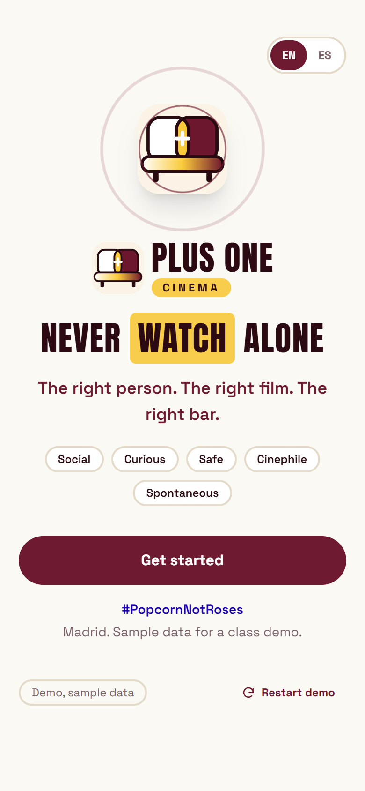

# Plus One Cinema

A social cinema app concept for Madrid: find the right person, the right film and the right bar, so nobody has to watch alone.

**Try it now: https://plusonecinema6866.z1.web.core.windows.net/** (no sign-up, works best on a phone)



## The idea

Going to the cinema alone is easy to skip and awkward to arrange with strangers. Plus One matches people who want to see the same film, suggests a nearby bar for afterwards, and puts safety first (including women-only matching, and a choice of who you would like to meet).

## What the demo shows

- Onboarding that captures your preferences and who you want to meet
- Matching with film, cinema and bar suggestions in Madrid
- Share-with-friends flow (WhatsApp, Telegram)
- English and Spanish interface

This is a clickable prototype for a class project. All films, cinemas, bars and people are fictional sample data. There is no backend, no real ID check and no payments.

## How it was built

I directed Claude Code (Anthropic's AI coding assistant) to build the prototype, making the product and design decisions myself. I am not a traditional developer.

- React and Vite, styled with Tailwind CSS
- Hosted on a Microsoft Azure Storage static website

## Run locally

```
npm install
npm run dev
```
